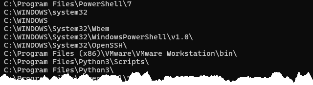
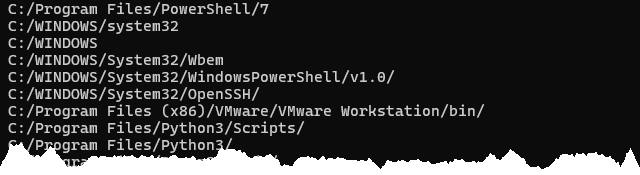
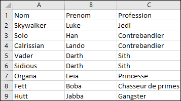
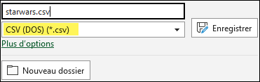
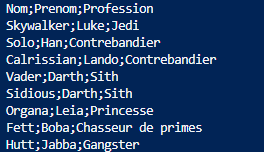
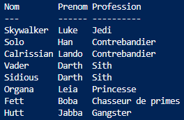
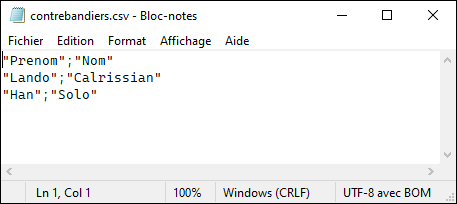
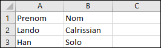
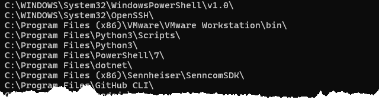

## Partie 3.1: Strings

Les exercices suivants visent à vous familiariser avec les chaînes de caractères en PowerShell.


**A)** Obtenir la liste de tous les chemins contenus dans la **variable d'environnement** `PATH`, sous forme de **tableau de strings**.




**B)** Inverser le sens des barres obliques dans la chaîne `C:\Windows\System32` pour qu'elle devienne `C:/Windows/System32` en utilisant une méthode de remplacement (`replace`).


**C)** En utilisant les solutions précédentes, inversez le sens des barres obliques pour tous les chemins de la variable `PATH`.




**D)** En utilisant PowerShell, rouver la ligne de commande qui donne le **nombre de mots** dans ce texte.

Pour répondre la question, créez la variable suivante (copier-coller):

```powershell
$montexte = "Lorem ipsum dolor sit amet, consectetur adipiscing elit. "      + `
    "Donec interdum ut lorem eget consequat. Nam sed leo hendrerit diam "    + `
    "pharetra blandit. Vestibulum enim diam, congue sit amet sem in, "       + `
    "maximus varius metus. Pellentesque in turpis rutrum, ornare ante a, "   + `
    "dapibus felis. Sed pellentesque, nunc non tincidunt pretium, velit "    + `
    "lorem scelerisque sem, quis tristique elit ex vel massa. Nam quam "     + `
    "magna, tempus sit amet lacus in, placerat suscipit velit. Aenean "      + `
    "eleifend fermentum risus, at laoreet urna malesuada nec. Etiam "        + `
    "tempus lectus scelerisque, sagittis elit sed, posuere nunc. Ut id "     + `
    "dictum libero, sed pharetra metus. Phasellus ac elit arcu. Fusce "      + `
    "nec luctus neque. In commodo id tellus at placerat. Class aptent "      + `
    "taciti sociosqu ad litora torquent per conubia nostra, per "            + `
    "inceptos himenaeos. Nam turpis tortor, eleifend ut tristique "          + `
    "vel, eleifend ut neque."
```


**E)** En utilisant le texte précédente, trouver la ligne de commande qui donne le **nombre de phrases**.


## Partie 3.2: Fichiers CSV

Dans le logiciel Excel, produisez un fichier CSV avec ces valeurs.

| Nom        | Prenom | Profession         |
| ---------- | ------ | ------------------ |
| Skywalker  | Luke   | Jedi               |
| Solo       | Han    | Contrebandier      |
| Calrissian | Lando  | Contrebandier      |
| Vader      | Darth  | Sith               |
| Sidious    | Darth  | Sith               |
| Organa     | Leia   | Princesse          |
| Fett       | Boba   | Chasseur de primes |
| Hutt       | Jabba  | Gangster           |


Voici ce que ça donne dans Excel.




Exportez ensuite le fichier en format CSV.




**A)** Avec PowerShell, utilisez la commande `Get-Content` pour voir le contenu de ce fichier texte. Vous devriez voir ceci:




**B)** Utilisez maintenant la commande `Import-Csv` pour importer le fichier sous forme d'un tableau d'objets. Vous devriez avoir une structure semblable à celle-ci:



** Attention au délimiteur! **


**C)** Donnez le **prénom** et le **nom** des **contrebandiers**, en ordre **alphabétique** de nom.


**D)** Sauvegardez ces nouvelles données dans le fichier contrebandiers.csv afin qu'il puisse être ouvert dans Excel (donc encore attention au délimiteur. Attention aussi à la première ligne qui contient l'information de type. Le fichier devrait ressembler à ceci:




Le fichier devrait pouvoir être ouvert dans Excel sans erreur.




## Partie 3.3: Questions sur `languages.csv`

Pour les questions suivantes, travaillez avec les données importées depuis le fichier `languages.csv`.

Contenu à copier dans `languages.csv`:

```csv
id;nom;date_de_création;version_actuelle;date_version_actuelle;nom_du_créateur;utilité;plateforme_principale
1;C++;1985-10-14;C++23;2023-10-03;Bjarne Stroustrup;Systèmes, applications performantes, moteurs de jeux;desktop
2;Python;1991-02-20;3.13;2024-10-07;Guido van Rossum;Automatisation, data science, IA, web;web
3;C#;2002-02-13;C# 13;2024-11-12;Anders Hejlsberg;Applications .NET, web, desktop, cloud;desktop
4;PowerShell;2006-11-14;7.5;2025-01-22;Jeffrey Snover;Administration système, automatisation, DevOps;desktop
5;Bash (Bourne Again Shell);1989-06-08;5.2;2022-09-26;Brian Fox;Scripting Linux/Unix, automatisation shell;desktop
6;Java;1995-05-23;Java SE 23;2024-09-17;James Gosling;Applications d'entreprise, backend, systèmes multiplateformes;web
7;JavaScript;1995-12-04;ECMAScript 2025;2025-06-26;Brendan Eich;Web frontend/backend, scripts multiplateformes;web
8;TypeScript;2012-10-01;5.8;2025-01-29;Anders Hejlsberg;Développement JavaScript typé pour applications robustes;web
9;Go;2009-11-10;1.24;2025-02-11;Robert Griesemer, Rob Pike, Ken Thompson;Services réseau, microservices, outils CLI;web
10;Rust;2010-07-07;1.84;2025-01-09;Graydon Hoare;Systèmes sécurisés, performance, sécurité mémoire;desktop
11;PHP;1995-06-08;8.4;2024-11-21;Rasmus Lerdorf;Développement web côté serveur;web
12;Ruby;1995-12-21;3.4;2024-12-25;Yukihiro Matsumoto;Scripting, web (Ruby on Rails), automatisation;web
13;Kotlin;2011-07-22;2.1;2024-11-27;JetBrains;Android, backend JVM, multiplateforme;mobile
14;Swift;2014-06-02;6.0;2024-09-16;Apple Inc.;Applications iOS/macOS, backend Swift;mobile
15;R;1993-08-01;4.4;2024-04-24;Ross Ihaka, Robert Gentleman;Statistiques, analyse de données, visualisation;desktop
16;SQL;1974-05-01;SQL:2023;2023-06-01;Donald D. Chamberlin, Raymond F. Boyce;Requêtes et gestion de bases de données relationnelles;web
```

**Q1)** Afficher tous les langages avec un ID supérieur à 5.

Réponse attendue:

```text
###########################################################
Q1: Tous les langages avec un ID supérieur à 5
###########################################################

id nom        date_de_création version_actuelle date_version_actuelle nom_du_créateur                          utilité
-- ---        ---------------- ---------------- --------------------- ---------------                          -------
6  Java       1995-05-23       Java SE 23       2024-09-17            James Gosling                            Applications d'entreprise, backend, systèmes multi…
7  JavaScript 1995-12-04       ECMAScript 2025  2025-06-26            Brendan Eich                             Web frontend/backend, scripts multiplateformes
8  TypeScript 2012-10-01       5.8              2025-01-29            Anders Hejlsberg                         Développement JavaScript typé pour applications ro…
9  Go         2009-11-10       1.24             2025-02-11            Robert Griesemer, Rob Pike, Ken Thompson Services réseau, microservices, outils CLI
10 Rust       2010-07-07       1.84             2025-01-09            Graydon Hoare                            Systèmes sécurisés, performance, sécurité mémoire
11 PHP        1995-06-08       8.4              2024-11-21            Rasmus Lerdorf                           Développement web côté serveur
12 Ruby       1995-12-21       3.4              2024-12-25            Yukihiro Matsumoto                       Scripting, web (Ruby on Rails), automatisation
13 Kotlin     2011-07-22       2.1              2024-11-27            JetBrains                                Android, backend JVM, multiplateforme
14 Swift      2014-06-02       6.0              2024-09-16            Apple Inc.                               Applications iOS/macOS, backend Swift
15 R          1993-08-01       4.4              2024-04-24            Ross Ihaka, Robert Gentleman             Statistiques, analyse de données, visualisation
16 SQL        1974-05-01       SQL:2023         2023-06-01            Donald D. Chamberlin, Raymond F. Boyce   Requêtes et gestion de bases de données relationne…
```

**Q2)** Afficher tous les langages dont la plateforme principale est web.

Réponse attendue:

```text
###########################################################
Q2: Tous les langages pour les plateformes web
###########################################################

id nom        date_de_création version_actuelle date_version_actuelle nom_du_créateur                          utilité
-- ---        ---------------- ---------------- --------------------- ---------------                          -------
2  Python     1991-02-20       3.13             2024-10-07            Guido van Rossum                         Automatisation, data science, IA, web
6  Java       1995-05-23       Java SE 23       2024-09-17            James Gosling                            Applications d'entreprise, backend, systèmes multi…
7  JavaScript 1995-12-04       ECMAScript 2025  2025-06-26            Brendan Eich                             Web frontend/backend, scripts multiplateformes
8  TypeScript 2012-10-01       5.8              2025-01-29            Anders Hejlsberg                         Développement JavaScript typé pour applications ro…
9  Go         2009-11-10       1.24             2025-02-11            Robert Griesemer, Rob Pike, Ken Thompson Services réseau, microservices, outils CLI
11 PHP        1995-06-08       8.4              2024-11-21            Rasmus Lerdorf                           Développement web côté serveur
12 Ruby       1995-12-21       3.4              2024-12-25            Yukihiro Matsumoto                       Scripting, web (Ruby on Rails), automatisation
16 SQL        1974-05-01       SQL:2023         2023-06-01            Donald D. Chamberlin, Raymond F. Boyce   Requêtes et gestion de bases de données relationne…
```

**Q3)** Afficher tous les langages dont la plateforme principale est desktop ou mobile.

Réponse attendue:

```text
###########################################################
Q3: Tous les langages pour les plateformes desktop ou mobile
###########################################################

id nom                       date_de_création version_actuelle date_version_actuelle nom_du_créateur              utilité
-- ---                       ---------------- ---------------- --------------------- ---------------              -------
1  C++                       1985-10-14       C++23            2023-10-03            Bjarne Stroustrup            Systèmes, applications performantes, moteurs de…
3  C#                        2002-02-13       C# 13            2024-11-12            Anders Hejlsberg             Applications .NET, web, desktop, cloud
4  PowerShell                2006-11-14       7.5              2025-01-22            Jeffrey Snover               Administration système, automatisation, DevOps
5  Bash (Bourne Again Shell) 1989-06-08       5.2              2022-09-26            Brian Fox                    Scripting Linux/Unix, automatisation shell
10 Rust                      2010-07-07       1.84             2025-01-09            Graydon Hoare                Systèmes sécurisés, performance, sécurité mémoi…
13 Kotlin                    2011-07-22       2.1              2024-11-27            JetBrains                    Android, backend JVM, multiplateforme
14 Swift                     2014-06-02       6.0              2024-09-16            Apple Inc.                   Applications iOS/macOS, backend Swift
15 R                         1993-08-01       4.4              2024-04-24            Ross Ihaka, Robert Gentleman Statistiques, analyse de données, visualisation
```

**Q4)** Afficher tous les langages qui ont plusieurs créateurs.

Réponse attendue:

```text
###########################################################
Q4: Tous les langages avec plusieurs créateurs
###########################################################

id nom date_de_création version_actuelle date_version_actuelle nom_du_créateur                          utilité                                                plateforme_principale
-- --- ---------------- ---------------- --------------------- ---------------                          -------                                                ---------------------
9  Go  2009-11-10       1.24             2025-02-11            Robert Griesemer, Rob Pike, Ken Thompson Services réseau, microservices, outils CLI             web
15 R   1993-08-01       4.4              2024-04-24            Ross Ihaka, Robert Gentleman             Statistiques, analyse de données, visualisation        desktop
16 SQL 1974-05-01       SQL:2023         2023-06-01            Donald D. Chamberlin, Raymond F. Boyce   Requêtes et gestion de bases de données relationnelles web
```

**Q5)** Afficher tous les langages plus vieux que l'an 2000.

Réponse attendue:

```text
###########################################################
Q5 : Afficher tous les langages plus vieux que l'an 2000
###########################################################

id nom                       date_de_création version_actuelle date_version_actuelle nom_du_créateur                        utilité
-- ---                       ---------------- ---------------- --------------------- ---------------                        -------
1  C++                       1985-10-14       C++23            2023-10-03            Bjarne Stroustrup                      Systèmes, applications performantes, …
2  Python                    1991-02-20       3.13             2024-10-07            Guido van Rossum                       Automatisation, data science, IA, web
5  Bash (Bourne Again Shell) 1989-06-08       5.2              2022-09-26            Brian Fox                              Scripting Linux/Unix, automatisation …
6  Java                      1995-05-23       Java SE 23       2024-09-17            James Gosling                          Applications d'entreprise, backend, s…
7  JavaScript                1995-12-04       ECMAScript 2025  2025-06-26            Brendan Eich                           Web frontend/backend, scripts multipl…
11 PHP                       1995-06-08       8.4              2024-11-21            Rasmus Lerdorf                         Développement web côté serveur
12 Ruby                      1995-12-21       3.4              2024-12-25            Yukihiro Matsumoto                     Scripting, web (Ruby on Rails), autom…
15 R                         1993-08-01       4.4              2024-04-24            Ross Ihaka, Robert Gentleman           Statistiques, analyse de données, vis…
16 SQL                       1974-05-01       SQL:2023         2023-06-01            Donald D. Chamberlin, Raymond F. Boyce Requêtes et gestion de bases de donné…
```

**Q6)** Afficher tous les langages plus récents que l'an 2000.

Réponse attendue:

```text
###########################################################
Q6 : Afficher tous les langages plus récents que l'an 2000
###########################################################

id nom        date_de_création version_actuelle date_version_actuelle nom_du_créateur                          utilité
-- ---        ---------------- ---------------- --------------------- ---------------                          -------
3  C#         2002-02-13       C# 13            2024-11-12            Anders Hejlsberg                         Applications .NET, web, desktop, cloud
4  PowerShell 2006-11-14       7.5              2025-01-22            Jeffrey Snover                           Administration système, automatisation, DevOps
8  TypeScript 2012-10-01       5.8              2025-01-29            Anders Hejlsberg                         Développement JavaScript typé pour applications ro…
9  Go         2009-11-10       1.24             2025-02-11            Robert Griesemer, Rob Pike, Ken Thompson Services réseau, microservices, outils CLI
10 Rust       2010-07-07       1.84             2025-01-09            Graydon Hoare                            Systèmes sécurisés, performance, sécurité mémoire
13 Kotlin     2011-07-22       2.1              2024-11-27            JetBrains                                Android, backend JVM, multiplateforme
14 Swift      2014-06-02       6.0              2024-09-16            Apple Inc.                               Applications iOS/macOS, backend Swift
```

**Q7)** Afficher tous les langages ayant comme utilité Android.

Réponse attendue:

```text
###########################################################
Q7 : Afficher tous les langages ayant comme utilité android
###########################################################

id nom    date_de_création version_actuelle date_version_actuelle nom_du_créateur utilité                               plateforme_principale
-- ---    ---------------- ---------------- --------------------- --------------- -------                               ---------------------
13 Kotlin 2011-07-22       2.1              2024-11-27            JetBrains       Android, backend JVM, multiplateforme mobile
```

**Q8 (bonus)** Pour chaque langage qui possède plusieurs créateurs, afficher **toutes les informations du langage** (id, nom, dates, version, utilité, plateforme, etc.), mais avec **une ligne par créateur**.

Autrement dit:
- Si un langage a un seul créateur, il n'est pas affiché.
- Si un langage a 2 créateurs, il apparaît sur 2 lignes.
- Si un langage a 3 créateurs, il apparaît sur 3 lignes.
- Sur chaque ligne, seule la valeur du champ `nom_du_créateur` change pour contenir un seul nom.

Réponse attendue:

```text
###########################################################
Q8 (bonus) : Pour chaque langage avec plusieurs créateurs, afficher toutes les informations du langage avec une ligne par créateur.
###########################################################

id nom date_de_création version_actuelle date_version_actuelle nom_du_créateur  utilité                                                plateforme_principale
-- --- ---------------- ---------------- --------------------- ---------------  -------                                                ---------------------
9  Go  2009-11-10       1.24             2025-02-11            Ken Thompson     Services réseau, microservices, outils CLI             web
9  Go  2009-11-10       1.24             2025-02-11            Ken Thompson     Services réseau, microservices, outils CLI             web
9  Go  2009-11-10       1.24             2025-02-11            Ken Thompson     Services réseau, microservices, outils CLI             web
15 R   1993-08-01       4.4              2024-04-24            Robert Gentleman Statistiques, analyse de données, visualisation        desktop
15 R   1993-08-01       4.4              2024-04-24            Robert Gentleman Statistiques, analyse de données, visualisation        desktop
16 SQL 1974-05-01       SQL:2023         2023-06-01            Raymond F. Boyce Requêtes et gestion de bases de données relationnelles web
16 SQL 1974-05-01       SQL:2023         2023-06-01            Raymond F. Boyce Requêtes et gestion de bases de données relationnelles web
```

:::tip
Piste: pour cette question, une approche simple est d'utiliser **deux `ForEach-Object`**.

Le premier parcourt chaque langage, puis le second parcourt la liste des créateurs de ce langage afin de produire une ligne par créateur.
:::


## Partie 3.4 (optionnel)

Voici des exercices optionnels sur les expressions régulières. Ces notions n'ont pas été présentées en classe mais sont disponibles dans les notes de cours. Elles ne seront pas validées en examen.

**A)** En utilisant **une expression régulière**, valider si la chaîne de caractères "A1B 2C3" correspond à **un code postal canadien** à l'aide de l'opérateur `-Match`.

*Note: Un code postal canadien est constitué ainsi: `lettre` `chiffre` `lettre` `espace` `chiffre` `lettre` `chiffre`.*


**B)** En utilisant **une expression régulière**, trouvez une ligne de commande qui retourne tous les chemins de la variable `PATH` qui **se terminent par un "\\"**.




