## Partie 1 - Découverte de WMI

WMI (Windows Management Instrumentation) permet d'interroger et d'administrer de nombreux composants Windows : processeur, mémoire, disques, services, processus, réseau, BIOS, utilisateurs, etc.

:::tip
Avec PowerShell 7, on privilégie les commandes CIM (Common Information Model), notamment :

```powershell
Get-CimInstance
New-CimSession
Get-CimClass
Invoke-CimMethod
```

:::

:::tip Indices
Classes utiles :

- `Win32_ComputerSystem`
- `Win32_Processor`
- `Win32_PhysicalMemory`
  :::

### a) Informations générales du PC

Afficher les informations suivantes :

- le nom du PC ;
- le fabricant ;
- le modèle.

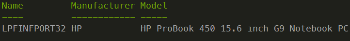

### b) Informations CPU

Afficher les informations suivantes :

- le nom du processeur
- le nombre de cœurs
- le nombre de processeurs logiques.

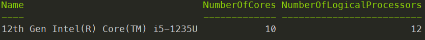

### c) Mémoire RAM

Afficher la quantité totale de RAM en Go, arrondie à deux nombres après la virgule.

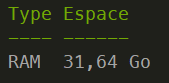

:::tip
1GB est une unité de taille reconnue directement par PowerShell. Elle représente une quantité de mémoire ou de stockage correspondant à 1 gigaoctet.

PowerShell reconnaît plusieurs unités :

```powershell
1KB   # Kilooctet
1MB   # Mégaoctet
1GB   # Gigaoctet
1TB   # Téraoctet
```

:::

:::tip
[math]::Round() est une méthode .NET disponible dans PowerShell qui permet d'arrondir un nombre.

```powershell
# Arrondit le nombre à 2 chiffres après la virgule
[math]::Round(12.34567, 2)
```

:::

:::tip
`[PSCustomObject]` permet de créer un objet personnalisé avec des propriétés nommées.

Cela est pratique pour afficher un résultat plus propre qu'une simple valeur.

```powershell
[PSCustomObject]@{
    Type = 'Pizza'
    Note = 4.3
}
```

Résultat : un objet avec les propriétés `Type` et `Note`, facile à afficher dans un tableau ou à réutiliser dans un script.

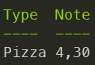

:::

---

## Partie 2 - Disques

Cette partie est consacrée à la gestion des disques avec la classe :

```powershell
Win32_LogicalDisk
```

### a) Lister les disques

Afficher les informations suivantes pour chaque disque (Format tableau) :

- la lettre du lecteur
- le nom du volume
- le système de fichiers
- la taille totale
- l'espace libre

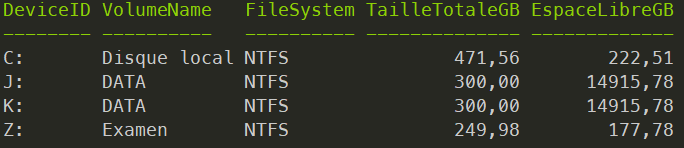

:::tip
Dans PowerShell, `@{}` permet de créer une **table de hachage** (_hashtable_).

Avec `Select-Object`, on peut utiliser une hashtable pour créer une **propriété calculée**, c'est-à-dire une nouvelle propriété dont la valeur est obtenue à partir d'un calcul ou d'une expression.

La syntaxe générale est :

```powershell
@{
    Name = "NomDeLaPropriete"
    Expression = {
        # Calcul ou expression
    }
}
```

Voici un exemple a l'aide de la commande `Get-PSDrive` :

```powershell
# Récupère le lecteur C:
Get-PSDrive C |
    Select-Object Name,
        @{
            Name = "TailleTotaleGB"
            Expression = {
              ($_.Used + $_.Free)
            }
        }
```

:::

### b) Afficher uniquement les disques locaux

Afficher uniquement les informations suivantes pour les disques locaux de l'ordinateur :

- le nom du lecteur
- le système de fichiers
- l'espace utilisé (en Go)
- l'espace libre (en Go)
- l'espace total (en Go)

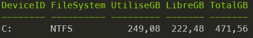

:::tip
La classe Win32_LogicalDisk contient plusieurs types de lecteurs : disques locaux, lecteurs réseau, lecteurs amovibles, lecteurs CD/DVD, etc.

La propriété 'DriveType' permet de déterminer le type de lecteur.
:::

### c) Détecter les disques presque pleins

Afficher uniquement les disques locaux dont l'espace libre est inférieur à 50 % du total. Pour chacun, affichez :

- le nom du lecteur
- l'espace total (en Go)
- l'espace libre (en Go)
- le pourcentage d'espace libre

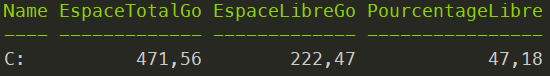

:::tip
Pour calculer le pourcentage d'espace libre, il faut diviser l'espace libre par l'espace total, puis multiplier par 100.

```powershell
$libre  = 20
$total = 500
$PourcentageLibre = [math]::Round((($libre / $total) * 100), 2)
```

:::

---

## Partie 3 - Réseau

Cette partie porte sur l'information réseau de l'ordinateur à l'aide des classes WMI suivantes :

```powershell
Win32_NetworkAdapter
Win32_NetworkAdapterConfiguration
```

### a) Lister les cartes réseau

Afficher les informations suivantes pour chaque carte réseau :

- le nom de l'adaptateur
- la description
- l'adresse MAC
- l'état de connexion

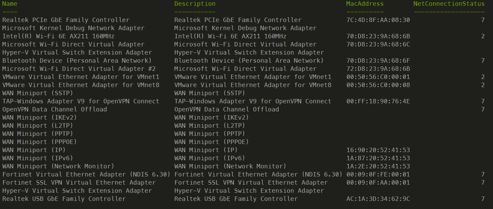

### b) Afficher les adresses IP

Afficher uniquement les interfaces réseau actives avec :

- le nom de l'adaptateur
- l'adresse IP
- le masque de sous-réseau
- la passerelle par défaut

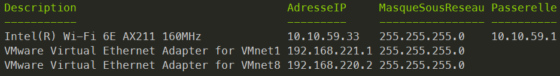

### c) Vérifier les paramètres DHCP

Afficher les cartes réseau qui utilisent DHCP, ainsi que :

- le nom de l'adaptateur
- le statut DHCP
- le ou les serveurs DNS
- l'adresse IP

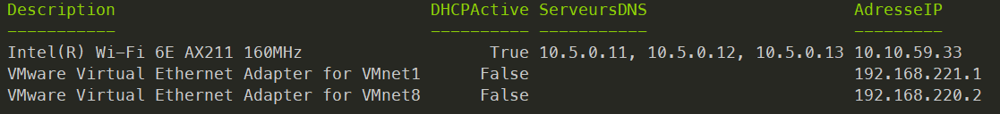

---

## Partie Challenge

Cette section contient des exercices plus complets. L'objectif est de combiner plusieurs classes WMI/CIM, de faire des calculs et de produire des objets PowerShell bien structurés.

### A) Tableau de bord système

Écrire un script qui affiche :

- l'utilisateur actuellement connecté ;
- le nom du poste ;
- les informations du processeur ;
- les informations de la carte graphique ;
- la quantité totale de RAM ;
- les 3 processus qui utilisent le plus de mémoire ;
- les disques ayant au minimum 30 % d'espace disponible.

Le résultat devrait être présenté en plusieurs sections claires ou sous forme d'un petit rapport.

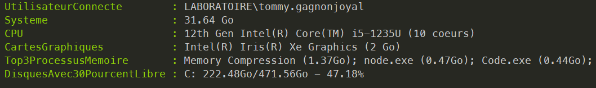

:::tip Indices
Classes utiles :

- `Win32_ComputerSystem`
- `Win32_Processor`
- `Win32_VideoController`
- `Win32_PhysicalMemory`
- `Win32_Process`
- `Win32_LogicalDisk`
  :::

### B) Inventaire matériel et système exportable

Écrire un script qui construit un objet PowerShell complet contenant au minimum :

- le nom du poste ;
- le fabricant et le modèle ;
- la version de Windows ;
- la date du dernier démarrage ;
- la quantité totale de RAM ;
- les informations CPU ;
- les informations BIOS ;
- le nombre de disques ;
- le nombre d'interfaces réseau actives.

Une fois l'objet construit, exportez-le en JSON ou en CSV.

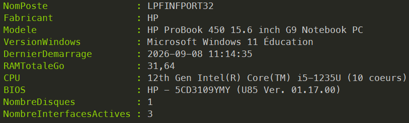

:::tip Indices
Classes utiles :

- `Win32_ComputerSystem`
- `Win32_OperatingSystem`
- `Win32_BIOS`
- `Win32_Processor`
- `Win32_LogicalDisk` ou `Win32_DiskDrive`
- `Win32_NetworkAdapterConfiguration`
  :::

---

## Solutions - Partie Challenge

### 1) Tableau de bord système

```powershell
$ordinateur = Get-CimInstance -ClassName Win32_ComputerSystem
$processeurs = Get-CimInstance -ClassName Win32_Processor
$cartesGraphiques = Get-CimInstance -ClassName Win32_VideoController
$processus = Get-CimInstance -ClassName Win32_Process |
    Sort-Object WorkingSetSize -Descending |
    Select-Object -First 3 |
    ForEach-Object {
        "$($_.Name) ($([math]::Round($_.WorkingSetSize / 1GB, 2))Go);"
    }

$disques = Get-CimInstance -ClassName Win32_LogicalDisk |
    Where-Object {
        $_.DriveType -eq 3 -and
        $_.Size -gt 0 -and
        (($_.FreeSpace / $_.Size) -ge 0.30)
    } |
    ForEach-Object {
        "$($_.Name) $([math]::Round($_.FreeSpace / 1GB, 2))Go/$([math]::Round($_.Size / 1GB, 2))Go - $([math]::Round(($_.FreeSpace / $_.Size) * 100, 2))%"
    }

$rapport = [pscustomobject]@{
    UtilisateurConnecte = $ordinateur.UserName
    Systeme = "$([math]::Round($ordinateur.TotalPhysicalMemory / 1GB, 2)) Go"
    CPU = $processeurs |
        ForEach-Object {
            "$($_.Name) ($($_.NumberOfCores) coeurs)"
        }
    CartesGraphiques = $cartesGraphiques |
        ForEach-Object {
            "$($_.Name) ($([math]::Round($_.AdapterRAM / 1GB, 2)) Go)"
        }
    Top3ProcessusMemoire = ($processus -join ' ')
    DisquesAvec30PourcentLibre = $disques
}

$rapport
```

```powershell
$interfaces = Get-CimInstance -ClassName Win32_NetworkAdapterConfiguration |
    Where-Object { $_.IPEnabled -eq $true } |
    ForEach-Object {
        [pscustomobject]@{
            Nom = $_.Description
            AdresseMAC = $_.MACAddress
            AdressesIP = $_.IPAddress
            Masque = $_.IPSubnet
            Passerelle = $_.DefaultIPGateway
            ServeursDNS = $_.DNSServerSearchOrder
            DHCPActive = $_.DHCPEnabled
        }
    }

$rapport = [pscustomobject]@{
    InterfacesActives = $interfaces
    Resume = [pscustomobject]@{
        TotalInterfacesActives = $interfaces.Count
        InterfacesAvecDHCP = ($interfaces | Where-Object DHCPActive -eq $true).Count
        InterfacesAvecPasserelle = ($interfaces | Where-Object { $_.Passerelle.Count -gt 0 }).Count
    }
}

$rapport
```

### B) Inventaire matériel et système exportable

```powershell
$ordinateur = Get-CimInstance -ClassName Win32_ComputerSystem
$os = Get-CimInstance -ClassName Win32_OperatingSystem
$bios = Get-CimInstance -ClassName Win32_BIOS
$processeurs = Get-CimInstance -ClassName Win32_Processor
$disques = Get-CimInstance -ClassName Win32_DiskDrive
$interfacesActives = Get-CimInstance -ClassName Win32_NetworkAdapterConfiguration |
    Where-Object { $_.IPEnabled -eq $true }

$inventaire = [pscustomobject]@{
    NomPoste = $ordinateur.Name
    Fabricant = $ordinateur.Manufacturer
    Modele = $ordinateur.Model
    VersionWindows = $os.Caption
    DernierDemarrage = $os.LastBootUpTime
    RAMTotaleGo = [math]::Round($ordinateur.TotalPhysicalMemory / 1GB, 2)
    CPU = $processeurs |
        ForEach-Object {
            "$($_.Name) ($($_.NumberOfCores) coeurs)"
        }
    BIOS = "$($bios.Manufacturer) - $($bios.SerialNumber) ($(($bios.SMBIOSBIOSVersion -join ', ')))"
    NombreDisques = $disques.Count
    NombreInterfacesActives = $interfacesActives.Count
}

$inventaire | ConvertTo-Json -Depth 5 | Set-Content -Path '.\inventaire-systeme.json'

$inventaire
```
